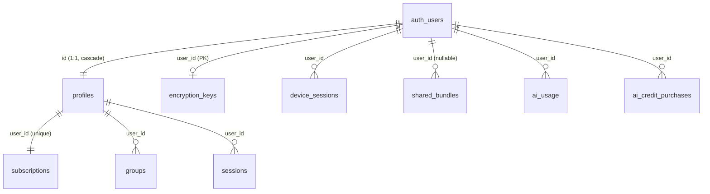

# Database Schema Reference

This is the per-table reference: columns, RLS, indexes and E2E encryption. For the day-to-day workflow (local stack, migrations, sync, queries) see [DATABASE.md](DATABASE.md).

The migrations in `supabase/migrations/` (`001`–`026`) are the source of truth. This doc is a snapshot of their end state, so read the SQL before relying on it for anything security-relevant.

## Migration history

| # | File | What it did |
|---|------|-------------|
| 001 | `001_initial_schema.sql` | `profiles`, `subscriptions`, `groups`, `sessions`. `handle_new_user()` trigger. `update_updated_at()` triggers on `groups` and `subscriptions` (`groups` uses `groups_set_updated_at()` since 020). |
| 002 | `002_rls_policies.sql` | RLS and owner-only policies on the four initial tables. |
| 003 | `003_indexes.sql` | Indexes on `groups`, `sessions`, `subscriptions`. |
| 004 | `004_create_organize_runs.sql` | `organize_runs` table and RLS (dropped by 024). |
| 005 | `005_subscription_lifecycle_columns.sql` | `subscriptions.cancel_at_period_end` and `stripe_price_id`. `current_period_end` was already there, so its `add column if not exists` is a no-op. |
| 006 | `006_ai_usage.sql` | `ai_usage` table (monthly AI quota) and RLS. |
| 007 | `007_public_group_sharing.sql` | `groups.public_slug` and `view_count`. `increment_group_view_count()` function. |
| 008 | `008_groups_missing_columns.sql` | `groups.permanent`, `starred`, `archived`, `note`. |
| 009 | `009_create_shared_bundles.sql` | `shared_bundles` table (public multi-group share snapshots) and RLS. |
| 010 | `010_grant_table_privileges.sql` | Grants only, no schema change (see [Grants](#grants-migration-010)). |
| 011 | `011_enable_realtime_groups.sql` | Adds `public.groups` to the `supabase_realtime` publication. |
| 012 | `012_dedupe_and_unique_subscriptions.sql` | Deletes duplicate `subscriptions` rows, keeping the newest per user. Adds `subscriptions_user_id_key UNIQUE(user_id)`. Drops the now-redundant `subscriptions_user_id_idx`. |
| 013 | `013_create_device_sessions.sql` | `device_sessions` table (per-device Now Open snapshots) and RLS. |
| 014 | `014_ai_credit_purchases.sql` | `ai_credit_purchases` table (one-time AI credit packs) and RLS. |
| 015 | `015_encryption_keys.sql` | `encryption_keys` table (wrapped E2E data key per user). Select/insert/update policies. |
| 016 | `016_group_counts.sql` | `groups.window_count` and `tab_count`, plaintext denormalized counts, backfilled from existing plaintext `windows`. |
| 017 | `017_rename_ai_usage_credits.sql` | Renames `ai_usage.request_count` to `credits_used` (weighted credits). |
| 018 | `018_encryption_keys_delete_policy.sql` | Adds the missing `encryption_keys` delete policy. Without it, `resetEncryption()` silently deleted 0 rows. |
| 019 | `019_gate_cloud_sync_rls.sql` | Adds `public.has_cloud_sync(uid)` — tier in `pro`/`pro_ai` and status in `active`/`trialing`/`past_due` (kept in sync with the shared `ENTITLED_SUBSCRIPTION_STATUSES` constant used by `resolveTier()` in `packages/extension/src/lib/entitlementTier.ts`). Replaces the insert/update policies on `groups`, `sessions`, `device_sessions`, `shared_bundles` (insert only) and `encryption_keys` to also require it, closing a gap where any signed-in free user could write sync rows directly (RLS previously only checked `auth.uid() = user_id`). `sessions` is gated too (owner decision: free users sync 0 sessions, keeping up to 3 locally only — the extension's free-tier upload path was removed in the same change). select/delete are untouched everywhere so downgraded users keep read/export/delete access. |
| 020 | `020_groups_position_keeps_updated_at.sql` | `groups_set_updated_at()` replaces `update_updated_at()` on `groups` only: a position-only or view_count-only update keeps `updated_at`, any other change stamps `now()`. |
| 021 | `021_profiles_server_managed.sql` | `profiles` is written only by the server (signup trigger and billing webhook): select is its only policy, and `anon`/`authenticated` hold `SELECT` only on the table. No schema change. |
| 022 | `022_ai_byok_and_cost_credits.sql` | `subscriptions.ai_mode` (`managed`/`byok`) and `ai_monthly_credits`. Service-role-only functions `ai_reserve_credits()` and `ai_settle_credits()` for atomic AI credit metering. Converts existing `ai_credit_purchases.credits` to the new unit (1 credit = USD 0.001 of AI cost). |
| 023 | `023_revoke_client_writes_billing_tables.sql` | `subscriptions`, `ai_usage` and `ai_credit_purchases` are written only by the server: `anon`/`authenticated` lose `INSERT`/`UPDATE`/`DELETE`/`TRUNCATE` and keep `SELECT`. No schema change. |
| 024 | `024_drop_organize_runs.sql` | Drops `organize_runs` (and its policy) after organize became a synchronous route. Fails instead if any function still names the table. Rollback: re-run 004's DDL; the rows only linked old workflow runs to owners. |
| 025 | `025_rate_limits.sql` | `rate_limit_counters` table and the service-role-only `rate_limit_take()`: fixed-window, per-key request limits shared by every server instance (first used by the billing routes). See the `rate_limit_counters` section below. |
| 026 | `026_rate_limit_fixes.sql` | `rate_limit_take()` reads the clock after its advisory lock, never moves a newer window back, runs with `lock_timeout = 1s`, refuses duplicate window lengths and no longer deletes rows itself. Adds the service-role-only `rate_limit_purge(p_limit)` and the pg_cron job `rate-limit-purge` (enables `pg_cron`). `rate_limit_counters` gets fillfactor 70 and autovacuum scale factor 0.05. |

> **Local ≠ hosted.** `supabase db reset` proves only that the migrations apply locally. It does not show that the hosted project has them: 009 and 010 once sat unapplied on Cloud until someone ran `supabase db push` by hand. Check `supabase migration list --linked` against **each** hosted project (preview and production, see [ARCHITECTURE.md § Environments](ARCHITECTURE.md#environments)).

## E2E-encrypted columns

For every signed-in Pro account, content is written as an `EncryptedBlob` `{v:1, iv, ct}`: AES-256-GCM, base64, from `packages/shared/src/crypto`. The server never holds the key. Readers call `isEncryptedBlob()` and still accept legacy plaintext rows, because older rows were never backfilled.

| Table | Ciphertext column | What's inside the blob | Plaintext columns blanked on write |
|---|---|---|---|
| `groups` | `windows` (jsonb) | `{name, windows, note, info}` | `name = ''`, `note = null`, `info = ''` |
| `sessions` | `groups` (jsonb) | `{name, groups, description}` | `name = ''`, `description = null` |
| `device_sessions` | `now_open_snapshot` (jsonb) | `{windows}` of the device's Now Open group | none (`device_name` stays plaintext) |
| `shared_bundles` | `groups_snapshot` (jsonb) | the shared `Group[]` | none |

- `groups`, `sessions` and `device_sessions` use the account data key. That key is wrapped in `encryption_keys` and cached unwrapped in the extension's `chrome.storage.local` (see `packages/extension/src/lib/encryptionKey.ts`). The web dashboard caches it in `sessionStorage` after a passphrase prompt.
- `shared_bundles` uses a **fresh per-share key**, returned once and carried only in the share URL's `#key=` fragment. Both the extension (`src/lib/sharing.ts`) and the web dashboard (`packages/web/lib/sharing.ts`) generate the key and encrypt the snapshot entirely client-side, then insert directly into `shared_bundles` via their respective Supabase clients — there is no API route in the path, so the server never sees plaintext or the key.
- Anything the server has to show without the key is kept in plaintext on purpose: `groups.color`, `starred`, `archived`, `updated_at`, `window_count`, `tab_count`.
- Server code must never treat these columns as plaintext. Run the `encrypted-column-auditor` agent on any API route that touches them.

## Tables

### `profiles`

This table extends `auth.users` with one row per user, created by `handle_new_user()`.

| Column | Type | Constraints |
|---|---|---|
| `id` | `uuid` | PK, `references auth.users(id) on delete cascade` |
| `email` | `text` | not null |
| `stripe_customer_id` | `text` | unique, nullable |
| `created_at` | `timestamptz` | not null, default `now()` |

**RLS:** `profiles_select_own` (`auth.uid() = id`) is the only policy: a user reads their own row. There is no insert, update or delete policy, and `anon` and `authenticated` hold only `SELECT` on the table (migration 021) (plus the non-data `REFERENCES`/`TRIGGER` defaults). Rows are created by the trigger (`security definer`) and updated by the service role (the Stripe webhook sets `stripe_customer_id`). No column is edited by its owner.

### `subscriptions`

There is **one row per user**, enforced by `subscriptions_user_id_key UNIQUE(user_id)` since migration 012. `handle_new_user()` creates the `'free_' || user_id` row. The Stripe webhook updates it with `upsert(..., { onConflict: 'user_id' })`.

| Column | Type | Constraints |
|---|---|---|
| `id` | `text` | PK. Stripe subscription id, or `'free_' \|\| user_id` for the trigger row |
| `user_id` | `uuid` | not null, unique, `references profiles(id) on delete cascade` |
| `tier` | `text` | not null, default `'free'`, one of `free`, `pro`, `pro_ai` |
| `status` | `text` | not null, default `'active'`, one of `active`, `canceled`, `past_due`, `trialing`, `incomplete` |
| `current_period_end` | `timestamptz` | nullable |
| `cancel_at_period_end` | `boolean` | default `false` (005) |
| `stripe_price_id` | `text` | nullable (005) |
| `ai_mode` | `text` | not null, default `'managed'`, one of `managed`, `byok` (022). Which Pro AI option: TabMerger's key (metered) or the customer's own Anthropic key (not metered) |
| `ai_monthly_credits` | `integer` | not null, default `0`, `>= 0` (022). Managed Pro AI allowance per month in credits; `0` for `byok` and non-AI plans |
| `created_at` | `timestamptz` | not null, default `now()` |
| `updated_at` | `timestamptz` | not null, default `now()`, bumped by trigger |

**RLS:** `subscriptions_select_own` only. Writes go through the service role (webhook) and the trigger. A signed-in user reads `ai_mode` and `ai_monthly_credits` on their own row and cannot change them: there is no write policy (migration 022 fails if one exists), and since 023 `anon`/`authenticated` hold `SELECT` only on the table, so a client write fails with `42501`.

**Indexes:** `subscriptions_status_idx` and the unique index behind `subscriptions_user_id_key`.

> Anything that INSERTs a second row for a user fails with `23505` on `subscriptions_user_id_key`, because the trigger has already created one. `supabase/seed.sql` still does this (not yet fixed).

### `groups`

Groups are synced from the extension. Local IndexedDB is written first, then `syncEngine.ts` upserts here.

| Column | Type | Constraints / notes |
|---|---|---|
| `id` | `text` | PK, generated by the extension |
| `user_id` | `uuid` | not null, `references profiles(id) on delete cascade` |
| `name` | `text` | not null. `''` when encrypted |
| `color` | `text` | not null, default `'rgba(128,128,128,1)'` |
| `position` | `integer` | not null, default `0`. The extension's sync push does not write it |
| `windows` | `jsonb` | not null, default `'[]'`. `ExtWindow[]`, or an `EncryptedBlob` |
| `info` | `text` | nullable. `''` when encrypted |
| `note` | `text` | nullable (008). `null` when encrypted |
| `permanent` | `boolean` | not null, default `false` (008). The Now Open group is never pushed |
| `starred` | `boolean` | not null, default `false` (008) |
| `archived` | `boolean` | not null, default `false` (008) |
| `public_slug` | `text` | unique, nullable (007). Set by `POST /api/groups/[id]/publish` |
| `view_count` | `integer` | not null, default `0` (007) |
| `window_count` | `integer` | not null, default `0` (016). Plaintext; the client computes it before encrypting |
| `tab_count` | `integer` | not null, default `0` (016). Same as `window_count` |
| `updated_at` | `timestamptz` | not null, default `now()`, bumped by trigger `groups_set_updated_at()` (020) on content changes, kept as-is on position-only updates. The last-write-wins key |
| `created_at` | `timestamptz` | not null, default `now()` |

**RLS:** full owner CRUD (`groups_select_own`, `_insert_own`, `_update_own`, `_delete_own`). No public select policy exists. Since 019, `_insert_own`/`_update_own` also require `public.has_cloud_sync(auth.uid())` (tier `pro`/`pro_ai` and status `active`/`trialing`/`past_due`) — cloud sync is a Pro/Pro AI feature; select/delete stay owner-only so a downgraded user keeps read/export/delete access.

**Realtime:** in the `supabase_realtime` publication (011). RLS applies to subscriptions.

**Function:** `increment_group_view_count(slug_param text)` is `security definer` and has no auth check inside. Nothing in the app calls it today.

**Indexes:** `groups_user_id_idx`, `groups_updated_at_idx (desc)`.

### `sessions`

Point-in-time snapshots of a user's groups. They are copies, not references to `groups.id`.

| Column | Type | Constraints |
|---|---|---|
| `id` | `text` | PK |
| `user_id` | `uuid` | not null, `references profiles(id) on delete cascade` |
| `name` | `text` | not null. `''` when encrypted |
| `description` | `text` | nullable. `null` when encrypted |
| `groups` | `jsonb` | not null, default `'[]'`. `Group[]`, or an `EncryptedBlob` |
| `created_at` | `timestamptz` | not null, default `now()` |

**RLS:** full owner CRUD. **Index:** `sessions_user_id_idx`. Since 019, insert/update also require `public.has_cloud_sync(auth.uid())` — owner decision: free users keep up to `FREE_SESSION_LIMIT` (3) sessions locally only and never sync them; the extension's `useSaveSession()`/`pushSessionToSupabase()` free-tier upload path was removed in the same change so the client and the DB gate agree.

### `device_sessions`

One row per (user, device) for "Continue on other device". Other devices of the **same** user read it. It does not share across users.

| Column | Type | Constraints |
|---|---|---|
| `id` | `uuid` | PK, default `gen_random_uuid()` |
| `user_id` | `uuid` | not null, `references auth.users(id) on delete cascade` |
| `device_id` | `text` | not null. Generated by the client, unique per user |
| `device_name` | `text` | not null, plaintext |
| `now_open_snapshot` | `jsonb` | not null, default `'[]'`. An `EncryptedBlob` for encrypted accounts |
| `last_active` | `timestamptz` | not null, default `now()` |
| `created_at` | `timestamptz` | not null, default `now()` |
| — | — | `unique(user_id, device_id)`. The extension upserts with `onConflict: 'user_id,device_id'` |

**RLS:** full owner CRUD (`device_sessions_*_owner`). **Index:** `device_sessions_user_id_last_active_idx (user_id, last_active)`. Since 019, insert/update also require `public.has_cloud_sync(auth.uid())` — "Continue on other device" is Pro/Pro AI only (the extension already no-ops these writes for free tier).

### `shared_bundles`

Immutable public share snapshots of one or more groups. `/share/[slug]` reads them.

| Column | Type | Constraints |
|---|---|---|
| `id` | `uuid` | PK, default `gen_random_uuid()` |
| `slug` | `text` | unique, not null |
| `user_id` | `uuid` | nullable, `references auth.users(id) on delete cascade` |
| `groups_snapshot` | `jsonb` | not null. An `EncryptedBlob` (per-share key), or legacy plaintext |
| `created_at` | `timestamptz` | default `now()` |
| `expires_at` | `timestamptz` | nullable |

**RLS:** `shared_bundles_select_public` uses `using (true)`, so **anyone can read**. `shared_bundles_insert_owner` is limited to `authenticated` with `user_id = auth.uid()`, and since 019 also `public.has_cloud_sync(auth.uid())` — sharing is a Pro/Pro AI feature (the extension throws client-side if `entitlements.sharing` is false). `shared_bundles_delete_owner` requires `user_id = auth.uid()`. There is **no update policy** because snapshots are immutable. **Index:** on `slug`.

### `encryption_keys`

One row per user: the E2E data key wrapped with a key derived from the user's passphrase. The server never sees the passphrase or the unwrapped key.

| Column | Type | Constraints |
|---|---|---|
| `user_id` | `uuid` | PK, `references auth.users(id) on delete cascade` |
| `wrapped_key` | `text` | not null. The AES-256 data key, AES-GCM-wrapped |
| `salt` | `text` | not null. PBKDF2 salt |
| `kdf_iterations` | `integer` | not null. PBKDF2 iterations (`KDF_ITERATIONS` = 600,000 for new keys) |
| `wrap_iv` | `text` | not null |
| `created_at` | `timestamptz` | not null, default `now()` |

**RLS:** owner select, insert, update (015) and delete (018). Since 019, insert/update also require `public.has_cloud_sync(auth.uid())` — E2E encryption setup is only reachable from the Pro-gated sync flow (`EncryptionSetupModal` is triggered from `useSync`'s doSync gate).

### `ai_usage`

Per-user, per-month AI credit counter. `credits_used` adds up a **weighted** cost per call (`CREDIT_COSTS` in `packages/web/lib/ai-usage.ts`).

| Column | Type | Constraints |
|---|---|---|
| `id` | `uuid` | PK, default `gen_random_uuid()` |
| `user_id` | `uuid` | not null, `references auth.users(id) on delete cascade` |
| `month` | `text` | not null, `'YYYY-MM'` |
| `credits_used` | `integer` | not null, default `0` (was `request_count` before 017) |
| — | — | `unique(user_id, month)` |

**RLS:** `"Users can read own usage"`, select only; since 023 `anon`/`authenticated` hold `SELECT` only on the table. The AI routes increment it through the service role. Before 022 the effective cap was `AI_MONTHLY_CAP` (300) plus the sum of `ai_credit_purchases.credits` for that month (`getEffectiveCap` in `packages/web/lib/ai-usage.ts`). Rows written before 022 hold the old weighted units and were not converted.

**Metering functions (022).** Both are `security definer` with an empty `search_path`, and only `service_role` can execute them (`anon`/`authenticated` get `42501`). Unit: 1 credit = USD 0.001 of AI cost.

- `ai_reserve_credits(p_user uuid, p_month text, p_amount integer) returns table(allowed boolean, remaining integer, cap integer)`. Cap = `subscriptions.ai_monthly_credits` when tier is `pro_ai`, `ai_mode` is `managed` and status is `active`/`trialing`/`past_due` (same list as `has_cloud_sync()`, mirrors `ENTITLED_SUBSCRIPTION_STATUSES`), else 0, plus that month's `ai_credit_purchases.credits`. Adds `p_amount` to `credits_used` only if the result stays within the cap, in one `insert ... on conflict do update ... where` statement: the conflicting row is locked and the condition is re-checked against its latest version, so concurrent reservations cannot both use the same headroom. Refused calls change nothing and do not create a row; `remaining` is never negative. Raises `22023` for `p_amount <= 0` or a month that is not `YYYY-MM`.
- `ai_settle_credits(p_user uuid, p_month text, p_delta integer) returns integer`: adds `p_delta` (usually negative, replacing a reservation with the real cost), clamped at 0. Returns the new `credits_used`, or `null` when the user has no row for that month (no row is created).

Called through PostgREST as `rpc('ai_reserve_credits', ...)`, which returns a one-row array.

### `ai_credit_purchases`

One-time AI credit packs. They are month-scoped and don't roll over. There is one row per Stripe Checkout session, so webhook redelivery is idempotent.

| Column | Type | Constraints |
|---|---|---|
| `id` | `uuid` | PK, default `gen_random_uuid()` |
| `user_id` | `uuid` | not null, `references auth.users(id) on delete cascade` |
| `month` | `text` | not null, `'YYYY-MM'` |
| `credits` | `integer` | not null. Since 022: 1 credit = USD 0.001 of AI cost (older rows were converted with `floor(0.40 * (units * 0.05 * 0.94 - 0.30) / 0.001)`, min 0) |
| `stripe_checkout_session_id` | `text` | not null, unique. A Stripe Checkout session id, or `grant_<uuid>` for a manual credit grant |
| `created_at` | `timestamptz` | not null, default `now()` |

**RLS:** `"Users can read own credit purchases"`, select only; since 023 `anon`/`authenticated` hold `SELECT` only on the table. Only the service role writes (Stripe webhook, manual grants, the dev-only usage reset). **Index:** `ai_credit_purchases_user_month_idx (user_id, month)`.

### `rate_limit_counters`

Fixed-window request counters (025, fixed in 026), shared by every web server instance. Not linked to any user: `key` is whatever the route counts by (a user id, a client IP; key an IPv6 client by its /64 prefix).

| Column | Type | Constraints |
|---|---|---|
| `bucket` | `text` | not null; the route's limit set, 1-64 of `[a-z0-9_:-]` (checked by `rate_limit_take()`) |
| `key` | `text` | not null; 1-200 characters (checked by `rate_limit_take()`) |
| `window_seconds` | `integer` | not null, `check (window_seconds between 1 and 86400)` |
| `window_start` | `timestamptz` | not null; start of the current window, aligned to the Unix epoch |
| `hits` | `integer` | not null, `check (hits >= 0)` |
| — | — | PK `(bucket, key, window_seconds)` |

**RLS:** on, with no policy, and `anon`/`authenticated`/PUBLIC hold no privileges: only the two functions below (and the service role) touch it. **Index:** `rate_limit_counters_window_start_idx (window_start)`, for the purge. **Storage (026):** `fillfactor = 70`, `autovacuum_vacuum_scale_factor = 0.05`, since every hit rewrites a row.

Both functions are `security definer` with an empty `search_path`, and only `service_role` can execute them (`anon`/`authenticated` get `42501`).

- `rate_limit_take(p_bucket text, p_key text, p_windows integer[], p_maxes integer[]) returns table(allowed boolean, retry_after_seconds integer)`. Counts one hit in every window (at most `p_maxes[i]` hits per `p_windows[i]` seconds) only when all have room; a refused call counts nothing and `retry_after_seconds` runs to the end of the latest full window (at least 1). Calls for one `(bucket, key)` are serialized by a transaction-scoped advisory lock, waited on for at most `lock_timeout = 1s` (then `55P03`), and the clock is read after the lock. A window is only ever reset forward: a call whose clock is behind a stored window is refused until that window starts, and leaves it unchanged. Raises `22023` for a bad bucket or key, arrays that are not one-dimensional with the same 1-5 elements, a window outside 1-86400 seconds or listed twice, or a max below 1. `packages/web/lib/rateLimit.ts` calls it and answers any error per the bucket's `onError`.
- `rate_limit_purge(p_limit integer default 1000) returns integer`: deletes up to `p_limit` (1-100000) rows whose window ended more than two days ago, oldest first, skipping rows another transaction has locked, and returns how many it deleted. Run by the pg_cron job `rate-limit-purge` every 10 minutes with `p_limit = 5000`.

## Grants (migration 010)

Local CLI stacks don't get the schema-level grants to `anon`/`authenticated` that Supabase Cloud provisions implicitly. Without them, Postgres rejects a query before RLS is even evaluated. Migration 010 grants `select, insert, update, delete` on all public tables, and on future ones via `alter default privileges`. RLS remains the access control. Server-written tables are narrower, so a client write is refused by the privilege check (`42501`) even if a write policy were ever added: migration 021 leaves the API roles with `select` only on `profiles`, and migration 023 does the same for `subscriptions`, `ai_usage` and `ai_credit_purchases`.

## How tables relate

- `profiles`, `subscriptions`, `groups` and `sessions` reference `public.profiles`. Every later table references `auth.users` directly. The two are equivalent in practice, because `profiles.id` cascades 1:1 from `auth.users.id`.
- `profiles` and `subscriptions` are managed by the trigger. Never INSERT into them from app code.
- `sessions.groups` and `shared_bundles.groups_snapshot` are **copies**. Editing or deleting a group later does not change them.
- Every FK is `on delete cascade`, so deleting an auth user removes their rows from all nine tables. `groups.archived` is a flag, not a soft-delete table.
- `rate_limit_counters` has no FK and is not in the diagram: a row keyed by a deleted user's id stays until `rate_limit_purge()` removes it, two days after its window ends, so at most about three days after the key's last hit (windows are at most one day; the purge runs every 10 minutes).

## TypeScript mirrors (`packages/shared/src/types/index.ts`)

These types only partly mirror the schema:

- `SupabaseGroup` is missing `public_slug`, `view_count`, `permanent`, `starred`, `archived` and `note`. It types `windows` as `ExtWindow[]` even though the value can be an `EncryptedBlob`.
- `Subscription` doesn't model `cancel_at_period_end`, `stripe_price_id`, `ai_mode` or `ai_monthly_credits`. `useEntitlements` selects them with its own local row type.
- `DeviceSession` covers `device_id`, `device_name`, `now_open_snapshot` and `last_active`.
- There are no shared types for `shared_bundles`, `encryption_keys`, `ai_usage` or `ai_credit_purchases`.
